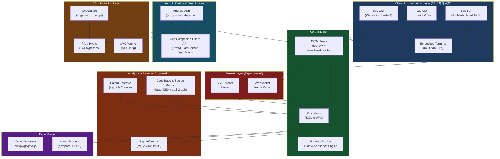
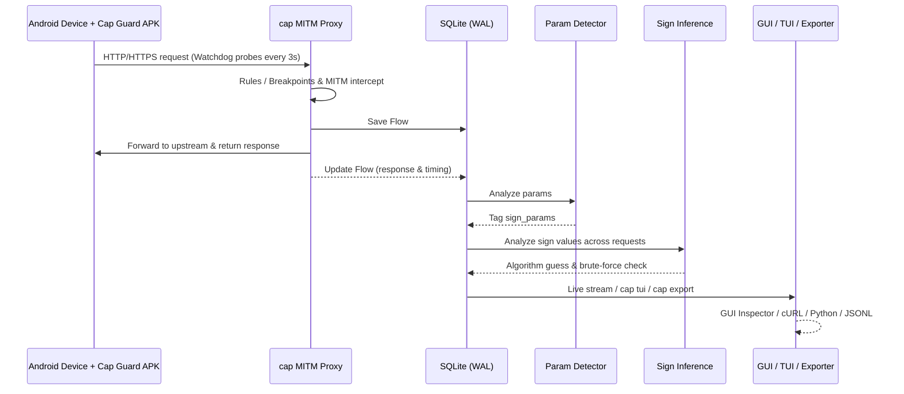

# cap

<p align="center">
  <strong>Commercial-grade HTTP(S) MITM proxy &amp; reverse-engineering workbench</strong><br>
  Native Desktop GUI · Full-Screen Interactive TUI · Android Companion Guard · EN / 简体中文 · LLM-Ready Output
</p>

<p align="center">
  <a href="README_CN.md">中文文档</a> ·
  <a href="https://overkazaf.github.io/cap/">Documentation &amp; Preview</a> ·
  <a href="#install--build">Install &amp; Build</a> ·
  <a href="#quick-start">Quick Start</a> ·
  <a href="#command-reference">CLI &amp; TUI Reference</a>
</p>

---

## Why cap?

Most HTTP proxies (Burp Suite, mitmproxy, HTTP Toolkit) are designed for web security testing rather than **mobile app reverse engineering**. `cap` combines a fast Go MITM core, a native Wails desktop workbench, a flicker-free full-screen TUI, and a self-healing Android Companion Guard APK into a single binary:

| Capability | Burp Suite | mitmproxy | HTTP Toolkit | **cap** |
|------------|:----------:|:---------:|:------------:|:-------:|
| CLI-first automation | ✗ GUI only | ✓ mitmdump | ✗ GUI only | **✓ ANSI CLI + `--json`** |
| Full-screen interactive TUI | ✗ | ✓ mitmproxy | ✗ | **✓ split-pane (`cap tui`)** |
| Native desktop GUI | ✗ Java/Swing | △ mitmweb (basic) | ✓ Electron | **✓ Wails v2 + Svelte 4** |
| Multi-language (`EN` / `简体中文`) | ✗ | ✗ | ✗ | **✓ GUI + TUI + CLI + APK** |
| LLM/Agent-ready output | ✗ XML/HAR | △ HAR (verbose) | △ HAR | **✓ compact JSONL** |
| Multi-language codegen | ✗ | △ curl + Python | ✗ | **✓ 5 languages** |
| Sign param auto-detect | ✗ | ✗ | ✗ | **✓** |
| Sign algorithm inference | ✗ | ✗ | ✗ | **✓ MD5/SHA/HMAC** |
| Static analysis & DeepTrace | ✗ | ✗ | ✗ | **✓ jadx / DEX / Call Graph** |
| One-cmd Android setup | ✗ | ✗ | △ app-based | **✓ ADB direct + Guard APK** |
| Auto network restore on disconnect | ✗ | ✗ | △ app-based | **✓ Companion Watchdog (rootless)** |
| Cert inject (Android 7–15) | ✗ manual | ✗ manual | ✓ | **✓ mount --bind / Magisk / KeyChain** |
| SSL unpinning | △ manual | ✗ | ✗ | **✓ Frida / patch / Magisk / CodeShare** |
| Intercept rules & breakpoints | ✓ | ✓ addon | ✓ Pro | **✓ rules + held breakpoints** |
| Request replay + diff | ✓ Repeater | ✗ | ✗ | **✓ modify-replay + side-by-side diff** |
| API auto-grouping & sequences | ✗ | ✗ | ✗ | **✓ host/path + token propagation** |
| Traffic dashboard | ✗ | ✗ | ✗ | **✓ P95 / timeline / TLS alerts** |
| Embedded terminal | ✗ | ✗ | ✗ | **✓ multi-tab PTY** |
| HAR / Charles import | ✓ | ✓ | ✓ | **✓** |
| WebSocket capture | ✓ | ✓ | ✓ | **⧗ experimental** |
| SSE stream capture | ✗ | △ | ✗ | **⧗ experimental** |
| Protobuf auto-decode | ✗ addon | △ addon | ✗ | **⧗ experimental (schema-less)** |
| Plugin system | ✓ BApp | ✓ addon | ✗ | **⧗ experimental (built-in analyzer)** |
| Single binary | ✗ JVM | ✗ Python | ✗ Electron | **✓ Go single binary** |
| Open source | ✗ ($449/yr) | ✓ | △ core only | **✓ MIT** |

### Maturity Labels

- **Stable**: covered by automated tests and suitable for daily use.
- **Experimental**: implemented and tested, but not yet validated across enough protocol/device combinations for unconditional claims.

The comparison table uses `⧗ experimental` where `cap`'s support exists but is not yet release-hardened. These labels are deliberately conservative.

---

## Architecture

### System Overview



### Data Flow



---

## Features

### Refactored Commercial Desktop GUI (`cap gui`)

Native Wails v2 + Svelte 4 desktop workbench compiled into a single binary (no Electron overhead):

- **Workbench Shell & Navigation**:
  - **4 Built-in Themes**: **Obsidian Dark** (default), **Porcelain Light**, **Mocha** (Catppuccin), and **Nord** with crisp 1px borders, layered elevation tokens, and `tabular-nums` monospace telemetry.
  - **Command Palette (`⌘K` / `Ctrl+K`)**: Instant jump across workspaces, proxy start/stop/pause, theme switching, and live `EN ↔ 简体中文` language toggling.
  - **Collapsible Left Nav Rail (`⌘B`)** with `⌘1–7` workspace shortcuts, live proxy status pill in the top bar, compact `EN / 中文` switcher, and an IDE-style bottom status bar.
- **7 Integrated Workspaces**:
  1. **Capture (`⌘1`)**: Live 4-KPI telemetry strip (`req/s` + bandwidth, total flows/bytes, active hosts + avg/P95 latency, error rate + TLS alerts), guided 4-step Android setup (`ADB Device` → `CA Certificate` → `Cap Companion Guard` → `Proxy Route`), domain scope filters, Frida controls, and a tabbed Activity Log / Active Hosts / TLS Alerts console.
  2. **Flows (`⌘2`)**: Multi-facet filter toolbar (`/` focus, host suggestions, method/status/content-type pills, Flat vs API Groups), horizontal/vertical draggable `SplitPane`, keyboard navigation (`↑/↓`/`j/k`, `Esc`), tabbed inspector (`Params`, `Req/Resp Headers`, `Req/Resp Body` with JSON / XML / Protobuf / Hex + inline search, `Raw`, `Timing`, `Export` to cURL/Python/Go/Java/JS/Agent JSONL), Replay & Modify-Replay, Side-by-Side Flow Diff, Sign Analysis, HAR/Charles Import, and Device Screen Mirror (`Fast` / `scrcpy`).
  3. **Rules (`⌘3`)**: Split-pane intercept rules engine + live **Held Breakpoints** queue (Forward Edited / Mock / Drop 403), 6 action types, priority ordering, and regex/substring path validation.
  4. **DeepTrace (`⌘4`)**: Flow + ADB package correlation pipeline, APK Manifest Inspector, Call Graph, DEX Strings, Java Source, Native SO analysis, Summary, and Mermaid export.
  5. **Plugins (`⌘5`)** *(Experimental)*: Split-pane analyzer studio with starter templates, `⌘S` save, and a draggable Test Runner drawer. *(Currently selects and runs built-in analysis modes; does not execute arbitrary JavaScript.)*
  6. **Terminal (`⌘6`)**: Multi-tab embedded PTY console (`⌘T` / `⌘W` / `Ctrl+Tab` / `Ctrl+L`) with quick diagnostic presets for `adb`, `frida`, and `curl`.
  7. **Settings (`⌘7`)**: Sectioned preferences for Appearance & Display Language (`English` / `简体中文`), Proxy & Certs, Android & Capture, Export & Storage, Shortcuts, and About & Diagnostics.

### Full-Screen Interactive TUI (`cap tui` & `cap start --tui`)

A flicker-free, double-buffered full-screen ANSI terminal UI (using DEC Synchronized Output + alternate screen + guaranteed terminal restore) with responsive wide (`≥110` cols) and stacked split-pane layouts:

```bash
cap start --tui                      # Live MITM proxy inside the interactive TUI
cap tui                              # Browse & inspect saved SQLite flows
cap tui --live -a 0.0.0.0:8080       # Live capture on all interfaces
cap tui -f 'm:POST s:4xx' --light    # Initial filter + Porcelain Light theme
cap tui --lang zh                    # Launch directly in Simplified Chinese
```

| Key | Action |
|-----|--------|
| `↑` / `↓` or `j` / `k` | Navigate flow list or scroll detail pane |
| `Tab` / `Shift+Tab` | Switch focus between flow list and inspector pane |
| `1` – `6` | Switch inspector tab: `1` Overview · `2` Request · `3` Response · `4` Headers · `5` Timing · `6` cURL/Code |
| `l` | Cycle codegen language on tab `6` (`curl`, `python`, `go`, `java`, `js`) |
| `/` | Open live filter bar (`m:POST s:4xx h:api.example.com !static`) |
| `m` / `e` / `c` | Cycle method filter / toggle errors-only (`4xx`/`5xx`) / clear filters |
| `f` / `p` | Toggle auto-follow newest flows / pause live stream |
| `z` | Zoom focused pane full-width |
| `r` | Async replay selected request |
| `y` / `x` | Copy cURL snippet to clipboard / export flow to file |
| `R` / `d` | Reload SQLite store / delete selected flow |
| `t` | Toggle **Obsidian Dark** ↔ **Porcelain Light** theme |
| `L` | Live hot-switch **`EN` ↔ `简体中文`** (with full CJK double-width alignment) |
| `?` / `q` / `Ctrl+C` | Toggle Help overlay / quit cleanly |

**Machine-readable CLI guarantee**: `--json`, `--format json`, `cap export`, `cap unpin script`, `NO_COLOR=1`, and non-TTY piped stdout always emit pure, uncolored output suitable for scripts and pipelines.

### Multi-Language Support (`EN` / `简体中文`)

Full bilingual localization across every surface of `cap`:

- **Desktop GUI**: Instant hot-switch via the top bar `EN / 中文` pill, bottom status bar, Command Palette (`⌘K`), or Settings → Language. Persisted automatically and synced with system locale on first launch.
- **Interactive TUI & CLI**: Auto-detected from `CAP_LANG` > `LC_ALL` > `LC_MESSAGES` > `LANG`, overridable via the persistent `--lang en|zh` flag on any command, or hot-toggled inside the TUI with `L`.
  - *Note*: On `cap export`, `-l` / `--lang` selects the generated code language (`curl`, `python`, `go`, `java`, `js`, `all`).
- **Android Companion Guard APK**: Native Android bilingual resources (`Cap Guard` / `Cap 代理守护`) adapting automatically to the device system language.

### Hardened Android Capture & Cap Companion Guard APK

Connecting a phone to a proxy should **never** leave the device stranded without internet when you unplug USB, switch Wi-Fi, or close the proxy.

`cap` embeds a signed, 33 KB, zero-dependency pure Android SDK APK (`com.overkazaf.cap.companion`, `minSdk=24`, `targetSdk=34`) directly inside the `cap` binary (`internal/android/bin/cap-companion.apk`):

- **Zero-Touch Deployment**: Automatically installed and started on `cap android connect` (skip with `--no-companion`) and GUI Connect.
- **Rootless Autonomous Proxy Cleanup**: `cap` grants `WRITE_SECURE_SETTINGS` and battery/background whitelisting over ADB on connect — **no root required** for autonomous Wi-Fi proxy restoration.
- **Active Heartbeat Watchdog (`ProxyGuardService`)**: Foreground service probes `proxy_host:proxy_port` every 3 seconds. After 3 consecutive misses — or on `ACTION_POWER_DISCONNECTED`, reboot (`BootReceiver`), or tapping **Restore Network / 恢复网络** directly in the notification — the APK autonomously clears `http_proxy` (and kills `cap-redir` / iptables rules in `--vpn` root mode) and posts a confirmation notification.
- **CA Certificate Lifecycle (Android 7–15)**:
  - **Rooted devices**: 3-strategy system cert injection (`mount --bind` for Android 10+, persistent Magisk module, or legacy `/system` remount) + `cap android cert --check` / `--remove`.
  - **Non-rooted devices**: Built-in `MainActivity` launches Android's `KeyChain` CA installer directly for `/sdcard/Download/cap-ca.crt` with guided verification.
- **Desktop Auto-Teardown**: `cap start --auto-disconnect`, `cap tui --live --auto-disconnect`, and Desktop GUI `StopProxy()` / `App.Shutdown()` automatically tear down tracked Android devices before stopping the proxy.

### SSL Unpinning

Four strategies to bypass app-level certificate pinning:

```bash
cap unpin frida --pkg com.example.app --spawn   # Frida: hooks 14+ pinning implementations
cap unpin patch --apk ./target.apk              # Patch: rewrite network_security_config.xml
cap unpin magisk                                # Magisk: promote user certs to system store
cap unpin codeshare --pkg com.example.app       # CodeShare: auto-fingerprint → matching scripts
cap unpin script                                # Print raw Frida unpinning JS to stdout
```

Covers TrustManagerImpl, OkHttp3 CertificatePinner, SSLContext, WebViewClient, Conscrypt, Flutter BoringSSL, Apache HTTP, TrustKit, Cordova, NetworkSecurityConfig, and more.

### Reverse-Engineering & Export Suite

- **Multi-Language Codegen**: Export any captured flow to runnable `curl`, `python` (`requests`), `go` (`net/http`), `java` (`OkHttp3`), `js` (`fetch`), or `all`.
- **LLM/Agent-Ready JSONL (`cap export -f agent`)**: Compact one-line-per-flow JSONL with noise headers stripped, `sign_params` auto-tagged, inline JSON bodies, and SHA-256 hashes for truncated large bodies.
- **Signature Algorithm Inference**: Length/encoding heuristics, cross-request consistency checks, and MD5/SHA1/SHA256/HMAC brute-force verification on sorted parameters.
- **API Auto-Grouping, Flow Compare & Sequence Replay**: Group endpoints by host/path prefix, diff any two flows side-by-side, and replay multi-step sequences with automatic token/cookie propagation.
- **HAR / Charles Import**: Import existing `.har` or Charles XML captures with zero friction.

---

## Install & Build

### Prerequisites

- **Go** `1.27+` (matches `go.mod`)
- **Node.js** `18+` (for building the Svelte 4 frontend)
- **macOS**: Xcode Command Line Tools (`xcode-select --install`)
- **Linux** (for Desktop GUI): `libgtk-3-dev libwebkit2gtk-4.0-dev`
- **Android** *(optional)*: `adb` in `PATH` for device capture; Android SDK `build-tools` only if rebuilding `android-companion/` from source (a prebuilt signed APK is already embedded)

### Recommended Full Build (Desktop GUI + TUI + CLI + Embedded Companion APK)

```bash
git clone https://github.com/overkazaf/cap.git
cd cap

# Build & sync Svelte frontend assets, verify SHA-256 match, and compile Wails desktop binary
make assets && make build

# Run
./dist/cap gui                     # Launch native Desktop GUI
./dist/cap tui --live              # Launch full-screen interactive TUI with live MITM proxy
./dist/cap --help                  # View CLI commands
```

> `make build` automatically sets `-tags 'desktop,production'` for Wails v2 and adds `-framework UniformTypeIdentifiers` on macOS.

### CLI & TUI Only (Fast Build without GUI)

```bash
git clone https://github.com/overkazaf/cap.git
cd cap
go build -o dist/cap ./cmd/cap
./dist/cap tui
```

### Verification & Tests

```bash
make test     # Run network-safe unit test suite
make check    # Run tests + frontend build + embedded asset SHA-256 check
```

### Rebuilding the Android Companion Guard APK *(Optional)*

`internal/android/bin/cap-companion.apk` is already checked in and embedded via `go:embed`. To rebuild it offline from source:

```bash
ANDROID_HOME=~/Library/Android/sdk ./android-companion/build.sh
```

---

## Quick Start

```bash
# 1. Start live MITM proxy inside the interactive full-screen TUI
./dist/cap start --tui -a 0.0.0.0:8080

# 2. Connect an Android device (sets proxy, installs CA cert, starts Cap Companion Guard watchdog)
./dist/cap android connect

# 3. Check Android proxy, CA cert, and Companion Guard watchdog status
./dist/cap android status

# 4. Query saved flows from CLI or browse in TUI
./dist/cap flows --host api.example.com --method POST -n 20
./dist/cap tui --filter 'm:POST s:4xx'

# 5. Export runnable code or compact LLM-ready JSONL
./dist/cap export --flow f1 -l python
./dist/cap export -f agent | pbcopy

# 6. Disconnect cleanly (or just close cap / unplug USB — Companion Guard auto-restores!)
./dist/cap android disconnect

# 7. Or launch the full Desktop GUI workbench
./dist/cap gui
```

---

## Command Reference

| Command | Description |
|---------|-------------|
| `cap gui [-d db]` | Launch the native Wails desktop GUI |
| `cap start [--tui] [-a addr] [-d db] [--auto-disconnect]` | Start MITM proxy (ANSI stream or `--tui` full-screen mode) |
| `cap tui [--live] [-a addr] [-f filter] [--light] [--no-color]` | Open interactive full-screen TUI for stored or live flows |
| `cap flows [--host] [--method] [--tag] [-s search] [-n limit] [--json]` | List and filter captured flows (`table` or `json`) |
| `cap export --flow <id> [-l curl\|python\|go\|java\|js\|all] [-f code\|agent]` | Export flow as runnable code or compact Agent JSONL |
| `cap android connect [--vpn] [--no-cert] [--no-companion] [-p port] [-s serial]` | Configure Android proxy, CA cert, and Companion Guard watchdog |
| `cap android status [--json] [-s serial]` | Inspect device identity, proxy, CA cert, and Companion Guard state |
| `cap android cert [--check\|--remove] [-s serial]` | Install, verify, or remove cap's CA certificate on device |
| `cap android disconnect [-s serial]` | Clear proxy, VPN redirect, and stop Companion Guard cleanly |
| `cap unpin frida --pkg <pkg> [--spawn]` | Runtime SSL pinning bypass via Frida (14+ hooks) |
| `cap unpin patch --apk <file>` | Patch APK `network_security_config.xml` to trust user CA |
| `cap unpin magisk` | Deploy system-wide Magisk CA cert promotion module |
| `cap unpin codeshare [--pkg <pkg>\|--query <q>]` | Fingerprint APK & search Frida CodeShare scripts |
| `cap unpin script` | Print raw Frida unpinning script to stdout |

**Global Flag**: `--lang en|zh` (auto-detected from `CAP_LANG` > `LC_ALL` > `LC_MESSAGES` > `LANG`).

---

## Project Structure

```text
android-companion/      Pure-SDK Android Companion Guard APK source & offline build.sh
cmd/cap/                Main entrypoint & embedded frontend/dist assets
frontend/
├── src/App.svelte      Workbench shell (collapsible nav rail, topbar, status bar, ⌘K)
├── src/components/     Icon, Badge, Button, SplitPane, CommandPalette, ToastHost, Kbd, EmptyState
├── src/lib/            tokens.css, theme.js (4 themes), i18n.js, locales/{common,core,tools}.js
└── src/pages/          Capture, Flows, Rules, DeepTrace, Plugins, Terminal, Settings
internal/
├── android/            ADB helpers, 3-strategy cert install/verify, companion.go, bin/cap-companion.apk
├── buildinfo/          Version injection metadata
├── capture/            WebSocket frame parser, SSE stream parser (experimental)
├── cli/                Cobra commands (start, tui, gui, flows, export, android, unpin)
├── compare/            Side-by-side flow comparison with structured diff
├── config/             Shared path defaults (~/.cap)
├── context/            jadx scanner, Retrofit/OkHttp parser, URL-to-source mapper
├── export/             codegen/ (5 languages) & agent/ (compact JSONL)
├── grouping/           API auto-grouping by host + path prefix
├── i18n/               Zero-dependency EN / zh-CN localization catalog for TUI & CLI
├── importer/           HAR and Charles proxy XML import
├── plugin/             Built-in analyzer plugin engine (experimental)
├── proto/              Schema-less protobuf wire format decoder (experimental)
├── proxy/              goproxy MITM core, ECDSA CA cert gen, stream capture
├── replay/             HTTP replay, request modification, response diff
├── rules/              Intercept rules, mocks, and held breakpoints persistence & engine
├── screen/             Android device screen mirror (screencap + scrcpy)
├── sequence/           Request sequence record/replay with variable propagation
├── sign/               Signature parameter detection, heuristics, brute-force verification
├── stats/              Traffic telemetry (P95 latency, error rate, timeline)
├── store/sqlite/       SQLite WAL persistence, filtering, JSON codec
├── terminal/           Multi-tab PTY backend for GUI Terminal
├── trace/              DeepTrace: DEX search, jadx, call-graph & native analysis
├── tui/                Flicker-free double-buffered ANSI full-screen TUI
├── types/              Flow, WSFrame, SSEEvent models
├── unpin/              SSL unpinning: Frida hooks, APK patch, Magisk, CodeShare
└── wailsgui/           Wails v2 desktop bindings, live events & graceful device teardown
docs/                   GitHub Pages site (Obsidian/Porcelain theme + EN/中文 switcher)
```

---

## License

MIT. See [LICENSE](LICENSE).

## Contributing

Issues and pull requests are welcome. See [CONTRIBUTING.md](CONTRIBUTING.md) for setup, testing, and security review guidelines.
